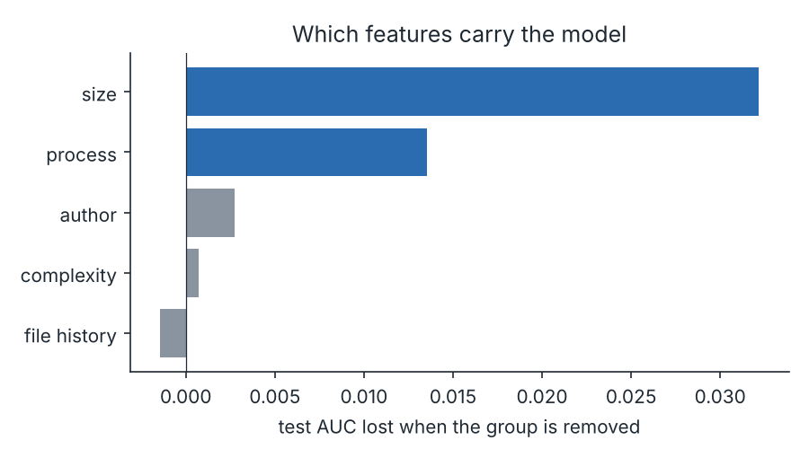
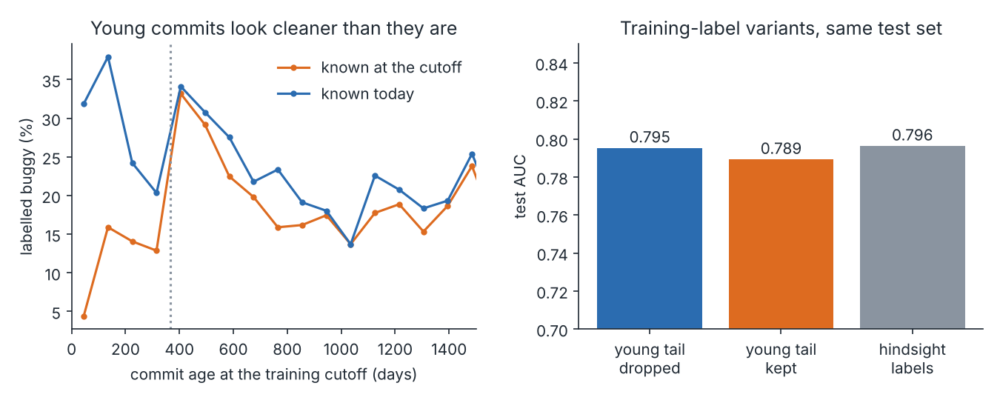
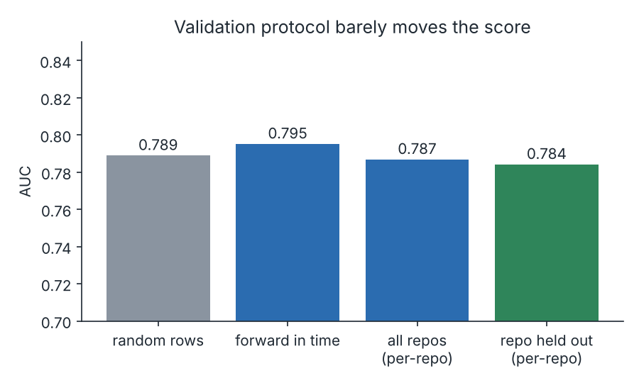
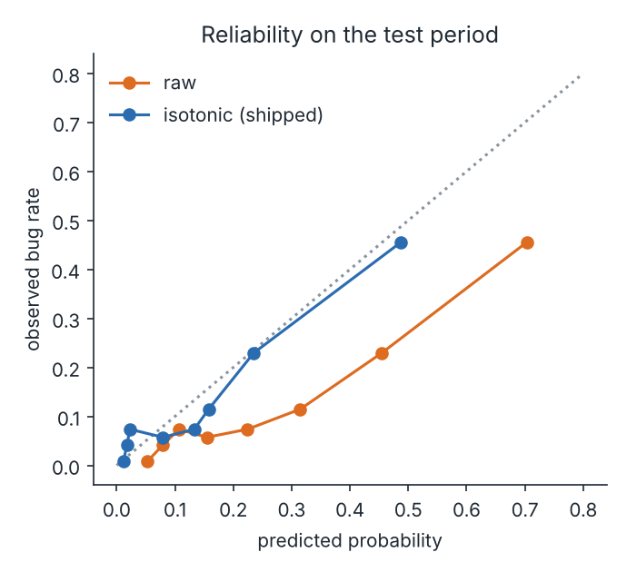
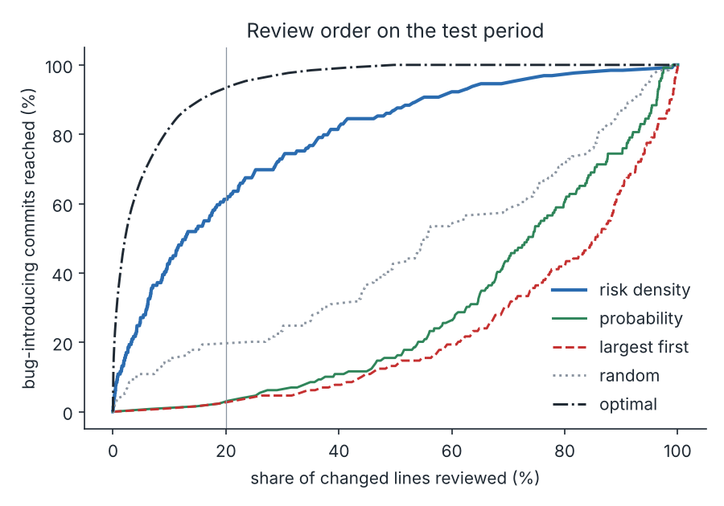
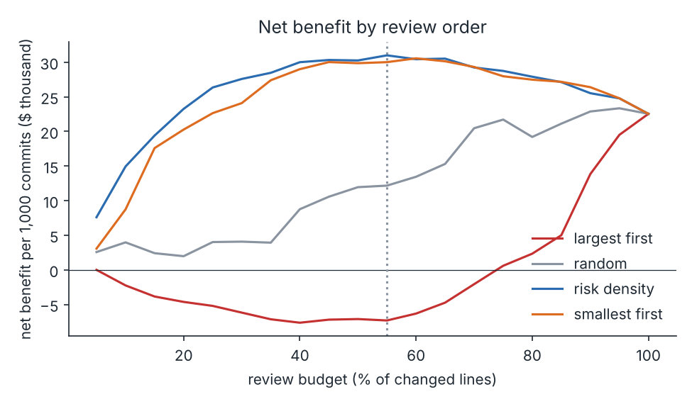

# patchrisk

[](https://github.com/ranjithguggilla/patchrisk/actions/workflows/ci.yml)

patchrisk ranks code changes by the chance that a later bug fix will point back at them. I trained it on the full history of six open-source Python projects (12,278 commits), labelled the commits with an SZZ-style blame pass, and validated it forward in time instead of on shuffled rows. The point of the project is less the model than the evaluation: most of the ways a commit-risk score can look better than it is are tested here, and the ones that turned out not to matter are reported as such.

The short version of what I found. A plain logistic regression on commit metadata ranks risky commits with a test AUC of 0.795 (95% interval 0.756 to 0.833), which beats a "bigger diff is riskier" rule at 0.764 but not by a lot. Change size explains most of the signal. Everything else I tried, including author experience, file history and code complexity, added very little.

## results

All numbers below come from `outputs/metrics.json`, produced by `patchrisk run`. The test period is every commit from mid-2022 to the end of October 2025 (977 commits, 74,193 changed lines, 13.2% later blamed for a bug). Each of those commits is at least a year old, so its label is mature. Intervals are 95% bootstrap intervals that resample whole repository-months, because commits in the same month are not independent.

| split | commits | share labelled buggy |
|---|---|---|
| train (before 2021, last year dropped) | 9,288 | 28.9% |
| validation (2021 to mid-2022) | 866 | 14.9% |
| test (mid-2022 to late 2025) | 977 | 13.2% |

Model comparison on the test period. The model was picked on validation log loss with a one-standard-error rule, which favours the simplest model inside the noise. Logistic regression scored 0.3848, boosting 0.3793 and the forest 0.3880, each with a standard error near 0.014, so logistic regression won on simplicity.

| ranking | test AUC | average precision |
|---|---|---|
| logistic regression on 24 commit features (shipped) | 0.795 | 0.426 |
| random forest | 0.785 | 0.341 |
| logistic regression on the size features alone | 0.784 | 0.417 |
| gradient boosting | 0.777 | 0.342 |
| "bigger diff first" rule | 0.764 | 0.377 |
| random order | 0.524 | 0.136 |

The AUC gap between the shipped model and the size rule is +0.031, with an interval of 0.008 to 0.050. It is real but small. Dropping whole feature groups and retraining shows where it comes from.



Removing the size features costs 0.032 AUC and removing the process features (message length, tests touched, hour, weekday and similar) costs 0.014. Author experience costs 0.003, complexity 0.001 and file history nothing. A rule that ranks commits by how often their files were changed before scores 0.461, which means those commits are slightly less likely to be blamed later, not more. That is the opposite of what I expected going in, and I have not found a convincing reason for it beyond these libraries having busy, well-reviewed core files.

### the labels are noisy

Bug-introducing commits are found by taking every commit whose message looks like a fix, blaming the lines it removed or changed, and calling the commits that last touched those lines bug-introducing. The keyword rule is crude. I read a seeded sample of 40 flagged messages by hand (`data/fix_message_audit.csv`) and 24 of them, 60%, read as real bug fixes. The rest were test repairs, docs, features that closed an issue and a few that I could not classify. The AUC numbers here measure agreement with this proxy, not with true defects.

### young commits look cleaner than they are

A commit made last month has had no time to be blamed for anything. At the training cutoff, the 685 commits from the final year had a 13.7% buggy rate with the fixes known then, against 28.2% once later history is included. I compared three ways of building the training labels, all scored on the same test commits.



| training labels | AUC | log loss |
|---|---|---|
| fixes known at the cutoff, final year dropped (shipped) | 0.795 | 0.3845 |
| fixes known at the cutoff, final year kept | 0.789 | 0.3587 |
| every fix ever mined | 0.796 | 0.3915 |

Ranking barely moves. The log loss ordering runs the other way from what I assumed, because the test period has a low bug rate and the variant that under-labels the most happens to match it best. I kept the dropped-tail version because it is the one you could actually run on the cutoff date.

### the split protocol did not matter much here



A random 70/30 split of the mature commits gives an AUC of 0.789 against 0.795 forward in time. Training on five repositories and testing on the sixth gives a mean AUC of 0.784 across the four repositories with at least 15 test-period bugs, against 0.787 when the model has seen the repository. So the score is not hiding a leak of that kind. It also does not say the model is good, only that it is as good under harsher splits as under easy ones.

| repository | test commits | test bugs | AUC, trained on all | AUC, repository held out |
|---|---|---|---|---|
| click | 209 | 42 | 0.809 | 0.804 |
| flask | 180 | 23 | 0.770 | 0.765 |
| httpx | 166 | 25 | 0.739 | 0.741 |
| werkzeug | 270 | 32 | 0.829 | 0.826 |

### calibration drifts

The share of commits later blamed for a bug fell from 28.9% in the training years to 13.2% in the test period. The raw model predicts 26.2% on average for the test commits, so its probabilities are about twice too high (expected calibration error 0.130). An isotonic map fitted on validation brings that to 0.033 on test. I decided to ship it by fitting on the first half of validation and checking the second half, where it cut the error from 0.131 to 0.049.



### what a review budget buys

Two views of the same ranking, because they disagree.

Reviewer time is spent per commit, so first ask which commits to look at. Taking the top 20% of commits by predicted probability catches 56.6% of the bug-introducing commits. The largest-first rule catches 47.3% and a random pick 19.4%. The gaps are +9.3 points (interval 4.0 to 15.6) against largest-first and +37.2 points (30.9 to 47.0) against random. The catch is that the probability-ranked 20% holds 77.5% of all changed lines, so this is a lot of reading.

If instead the budget is counted in changed lines, the best order is probability divided by size, which in practice means reading small commits first.



With 20% of the lines reviewed, that order reaches 61.2% of bug-introducing commits, against 16.3% for random. But the plain "smallest commit first" rule reaches 58.1%, and the difference between the two, 3.1 points, has an interval of -1.7 to +8.5 that includes zero. The model is not adding much once the budget is measured in lines. I mention it because effort-aware scores on commit data are easy to flatter this way.

The dollar view uses assumptions I made up and stated below, so treat it as a template, not a finding. The review budget (55% of changed lines) was chosen on the validation period and then applied to test.

| review order | commits read | bugs in the list | net benefit per 1,000 commits |
|---|---|---|---|
| probability per changed line | 943 | 116 | $31,001 |
| smallest first | 955 | 115 | $30,018 |
| random | 469 | 68 | $12,175 |
| largest first | 39 | 20 | -$7,312 |
| review everything | 977 | 129 | $22,549 |



Against largest-first the model order is ahead by $38,313 per 1,000 commits (interval $21,906 to $54,181) and against random by $18,825 ($6,157 to $30,162). Against smallest-first it is ahead by $984, with an interval of -$966 to +$2,191. At these assumptions the break-even cost of an escaped defect is $1,130, below which reviewing by this order loses money.

The assumptions, all in `economics.py`: a reviewer reads 200 changed lines an hour, each commit carries 15 minutes of fixed overhead, an hour costs $90, a defect that escapes costs $2,000 to find, fix and ship, and a deep review prevents 30% of the defects in a commit it covers. Change them and the table moves.

## architecture

```
 git clones (6 repos, pinned SHAs)
        |
        v
 mining.py  -- PyDriller walk, oldest first ------------------+
   per commit: size, spread, entropy, author history,         |
   file history, radon complexity, message flags              |
   SZZ pass: blame lines removed by fix commits               |
        |                                                     |
        v                                                     |
 data/commits.csv   data/fix_links.csv                        |
        |                                                     |
        v                                                     v
 labels.py  --> label as of a date, drop immature tail   evaluate.py
        |            (train / validation / test by time)  AUC, ECE, effort
        v                                                curves, bootstrap
 model.py   logistic | boosting | forest -> one-SE pick       |
        |                                                     |
        v                                                     |
 pipeline.py  maturity study, split study, ablation, <--------+
              economics (economics.py), calibration
        |
        +--> outputs/metrics.json, outputs/tables/*, assets/*.png
        +--> outputs/bundle.joblib  --> score.py --> app.py (Gradio)
```

## installation

```bash
git clone https://github.com/ranjithguggilla/patchrisk.git
cd patchrisk
python -m venv .venv && source .venv/bin/activate
pip install -r requirements.txt
pip install -e .
```

Python 3.10 or newer works. The pins in `requirements.txt` are the versions the results were produced with.

## usage

The mined data is committed, so the study runs without cloning anything.

1. Train, evaluate and regenerate every chart and table:

   ```bash
   patchrisk run
   ```

   It takes about ten seconds. The shipped model is a logistic regression and the run is deterministic, so metrics.json should reproduce to the last digit.

2. Open the scoring app:

   ```bash
   patchrisk app
   ```

   The first tab scores a commit from a handful of fields and gives three plain-language reasons. The second lists the highest-risk commits of the test period.

3. Score from Python:

   ```python
   from patchrisk.score import load_bundle, score_commit

   bundle = load_bundle()
   score_commit({"la": 220, "ld": 40, "nf": 6, "n_code_files": 6, "nd": 3, "author_exp": 0}, bundle)
   ```

   Features you leave out fall back to the training median.

4. Rebuild the data from the source repositories (slow, it clones six repositories and blames every fix):

   ```bash
   patchrisk mine
   ```

## configuration

Everything lives in `src/patchrisk/config.py`: the repositories and the commit each one is pinned to, the keyword rules that decide what counts as a fix, the label window (365 days), the three split dates and the feature list. Review-cost assumptions are the `Assumptions` dataclass in `economics.py`.

## output structure

```
outputs/
  metrics.json          every number quoted in this README
  bundle.joblib         fitted model, calibrator, background sample (not committed)
  tables/
    bug_rate_by_year.csv
    label_maturity_curve.csv
    repo_held_out.csv
    budget_sweep.csv
    top_risk_test.csv
assets/                 charts embedded above
```

## project structure

```
src/patchrisk/
  config.py      repositories, rules, split dates, feature list
  mining.py      git walk, features, SZZ links
  labels.py      labels as of a date, forward split, tail dropping
  model.py       candidates, one-SE choice, occlusion reasons
  evaluate.py    ranking, calibration and effort metrics, clustered bootstrap
  economics.py   review-budget arithmetic
  pipeline.py    the whole study
  report.py      charts
  score.py       single-commit scoring
  app.py         Gradio front end
  cli.py         mine, run, app
tests/           42 tests
data/            commits.csv, fix_links.csv, fix_message_audit.csv
```

## technical details

Features are computed from history strictly before each commit: lines added and deleted, files, directories, change entropy across files (how evenly the edit is spread), author experience and recent activity, the average prior change count and age of the touched files, the number of earlier authors on them, cyclomatic complexity change from radon, and a few message and timing flags. Right-skewed columns get a signed log before scaling for the linear model.

SZZ is done by PyDriller's blame of the lines a fix commit changed, ignoring whitespace. Fix commits touching more than 20 files are skipped because they are usually refactors, and only Python files are blamed. A commit counts as bug-introducing once any fix commit blames it.

Validation commits and test commits are labelled with every fix known today, since they are all more than a year old. Training labels use the variant named in the maturity study. Selection uses the one-standard-error rule on validation log loss, with the order logistic, boosting, forest.

The reasons shown in the app come from occlusion: each feature is replaced by its background median in turn and the change in log-odds is reported for the three largest movers.

## testing

```bash
pytest -q --cov=patchrisk
ruff check .
```

42 tests, 95% line coverage. They include a real throwaway git repository created in a temp directory, where the SZZ step has to link a fix back to the commit that wrote the wrong line, plus hand-computed economics, checks that no training row postdates the cutoff, and a full run whose AUC has to match the committed metrics.

## dataset credit

The history comes from the public GitHub repositories [pallets/click](https://github.com/pallets/click), [pallets/flask](https://github.com/pallets/flask), [encode/httpx](https://github.com/encode/httpx), [pallets/jinja](https://github.com/pallets/jinja), [psf/requests](https://github.com/psf/requests) and [pallets/werkzeug](https://github.com/pallets/werkzeug). The derived CSVs contain commit hashes, subject lines and numeric features, not source code. Each project keeps its own license.

## license

MIT, see `LICENSE`.
